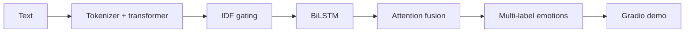

    

<strong>A multi-label emotion-classification system that fuses transformer context, IDF weighting, BiLSTM sequence features, and attention.</strong>

## Overview

A multi-label emotion-classification system that fuses transformer context, IDF weighting, BiLSTM sequence features, and attention.

### Why it matters

EmotionX explores richer representations for language that can express several emotions at once, with separate modules for training, evaluation, visualization, and demo use.

## Key features

- Transformer-based text representations
- IDF-gated token features
- Bidirectional LSTM and attention fusion
- Gradio interface for interactive inference

## Architecture

## Technology stack

**python** · **pytorch** · **transformers** · **scikit learn** · **gradio**

## Getting started

Create a Python environment from `requirements.txt`, obtain the expected dataset and pretrained model assets, then use `main.py` to access the project modes. Keep data and model licensing in scope when sharing a demo.
