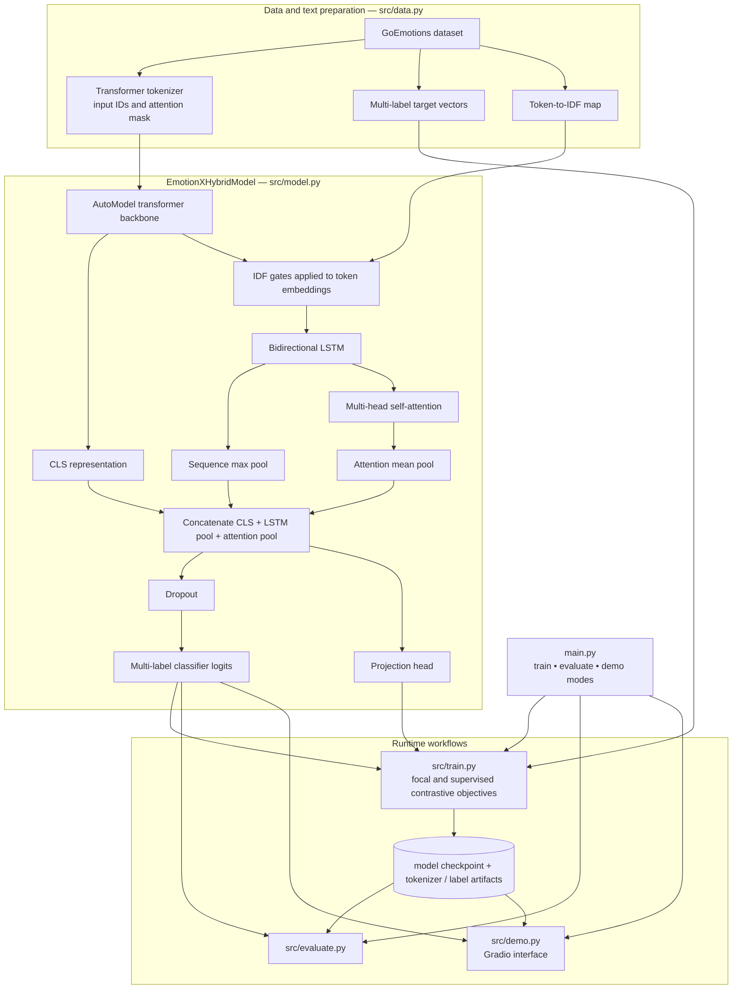

# EmotionX

**Hybrid deep learning for multi-label emotion classification**

## Overview

EmotionX is a natural-language processing project that recognizes multiple emotions in a text sample using a hybrid neural architecture. It combines contextual transformer representations, TF-IDF-based feature weighting, bidirectional sequence modeling, and attention before producing multi-label emotion predictions.

### Why this project matters

Language can express overlapping emotional signals that are not well represented by a single label. The project explores how contextual and sequential representations can be combined within a reproducible classification workflow.

## Key capabilities

- Processes input text using a transformer tokenizer and encoder.
- Uses TF-IDF-informed gating to emphasize informative features.
- Applies bidirectional LSTM layers to model token sequences.
- Uses attention and feature fusion before multi-label classification.
- Separates training, inference, evaluation, and visualization modules.
- Provides an interactive Gradio demonstration path.
- Supports loading pretrained artifacts or training new models.

## System architecture




### How it works

Text is tokenized and represented through a pretrained transformer. A token-importance mechanism and bidirectional recurrent layer provide complementary information to an attention-based fusion stage. The resulting representation is mapped to multiple emotion labels.

The command-line entry point selects training, evaluation, or demo workflows. Model assets and dataset permissions are managed separately from source code.

## Technology stack

| Technology | Purpose |
| --- | --- |
| **Python / PyTorch** | Neural network training and inference |
| **Hugging Face Transformers** | Tokenizer and contextual encoder |
| **scikit-learn** | TF-IDF and supporting utilities |
| **Gradio** | Interactive inference interface |
| **pandas / NumPy** | Dataset and feature manipulation |

## Repository structure

```text
main.py           Command-line entry point
src/model.py      Hybrid neural architecture
src/data.py       Dataset and preprocessing
src/train.py      Training workflow
src/evaluate.py   Evaluation workflow
src/demo.py       Interactive demo
src/utils.py      Model loading and shared utilities
models/           Local pretrained or generated artifacts
data/             Dataset placement instructions
```

## Getting started

```bash
python3 -m venv .venv
source .venv/bin/activate
pip install -r requirements.txt
# Supply the required dataset/model assets.
python main.py --mode demo
```

## Notes and prerequisites

See the `data/` instructions for required assets. If pretrained weights are not present, obtain permitted weights or train a model before running inference. This is a research-oriented text classifier, not a clinical emotion assessment.
