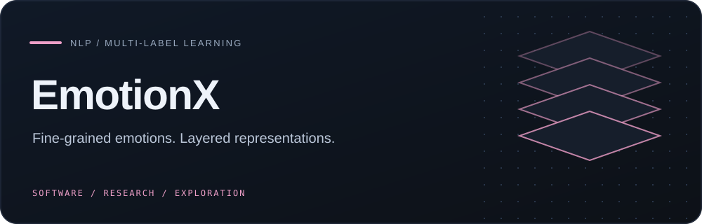
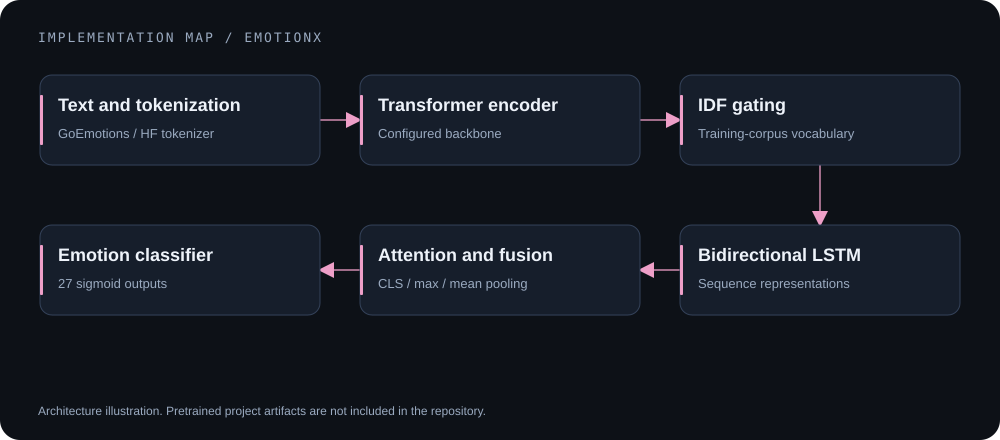
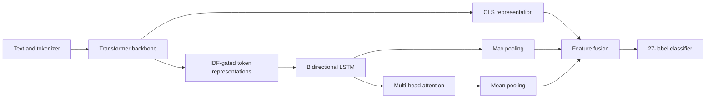
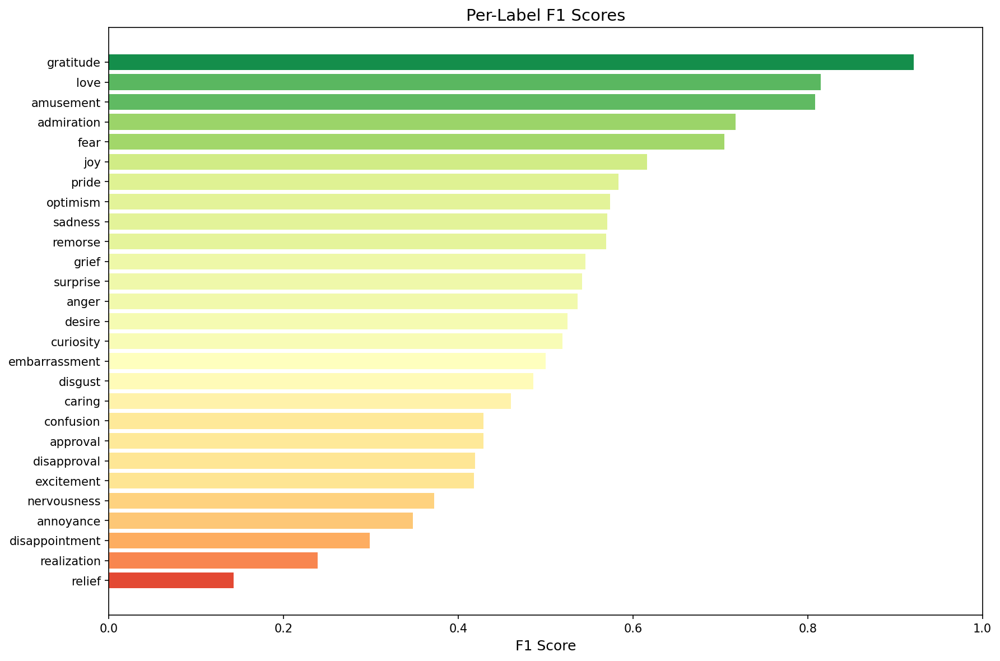
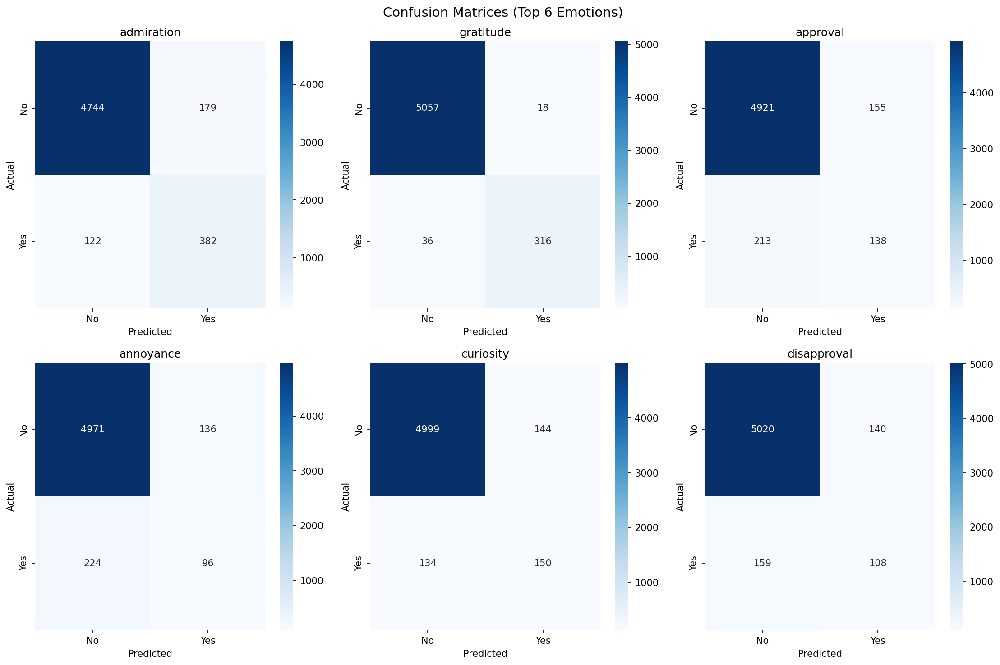

# EmotionX

    

**Multi-label emotion classification with a transformer encoder, IDF gating, bidirectional LSTM, and attention-based feature fusion.**

[Model](#model-architecture) · [Saved results](#saved-results) · [Reproduction](#setup-and-artifacts) · [Limitations](#research-boundaries)

## Research question

How can contextual transformer features be combined with sequential and token-importance representations for fine-grained emotion classification? EmotionX implements a hybrid model for 27 emotion labels using GoEmotions, with separate training, evaluation, visualization, and Gradio demo modules.

This is an implemented research project. The architecture's added complexity is not established as an improvement over a transformer-only baseline by the committed evidence.

## Model architecture





The configured backbone is DeBERTa-v3-large; the training code can fall back to other backbones. Record the actual selected backbone for any reproduced run. IDF values are fitted to training text, and the classifier uses focal loss.

## Implemented components

| Module | Responsibility |
|---|---|
| [src/data.py](src/data.py) | Dataset loading, label conversion, split preparation, tokenizer and IDF vocabulary |
| [src/model.py](src/model.py) | Hybrid model, pooling, focal loss, optional contrastive objective |
| [src/train.py](src/train.py) | Training, validation and checkpoint selection |
| [src/evaluate.py](src/evaluate.py) | Evaluation and saved reports |
| [src/demo.py](src/demo.py) | Interactive prediction interface |
| [src/config.py](src/config.py) | Model and training configuration |

## Saved results

The committed [classification report](results/classification_report.txt) records:

| Metric | Saved report value |
|---|---:|
| Micro-F1 | 0.5787 |
| Macro-F1 | 0.5218 |
| Test examples | 5,427 |

**These are stored project results, not independently reproduced measurements.** The corresponding trained artifact set is absent from this repository. No baseline comparison or ablation result is implied.



<details>
<summary>View existing confusion-matrix visualizations</summary>



</details>

## Setup and artifacts

```bash
python -m venv .venv
source .venv/bin/activate
pip install -r requirements.txt
```

Dependencies are minimum versions, not a locked reproduction environment. Dataset/backbone downloads require network access; tokenizer prerequisites and resource needs depend on the chosen backbone.

**Pretrained project weights are not included.** Default evaluation/demo expects a complete compatible set under `models/pretrained/`: model state, training config, labels, token-to-IDF vocabulary, and tokenizer files. No public download URL is currently supplied.

To train your own model, after reviewing compute/storage requirements:

```bash
python main.py --mode train
# After successful training writes models/trained/:
python main.py --mode evaluate --use-trained
python main.py --mode demo --use-trained
```

`--quick-test` evaluates a small sample; it is not a replacement for an automated test suite. Avoid treating model training as a quick installation check.

## Research boundaries

- Padding is not excluded from all pooling operations; batch-length sensitivity needs investigation.
- CPU best-checkpoint snapshots use `.cpu()` without cloning and may share live tensor storage.
- The official dataset validation split is not used directly; code creates a validation subset from the training split. The neutral label is excluded from outputs.
- No checked-in automated tests or independently repeated hardware/runtime benchmarks were established by the audit.

## Data and references

Data is loaded through Hugging Face Datasets. See [data notes](data/README.txt), [result notes](results/README.txt), and the GoEmotions paper: Demszky et al., *GoEmotions: A Dataset of Fine-Grained Emotions*, ACL 2020. Respect the dataset and selected backbone's licenses and usage conditions.
